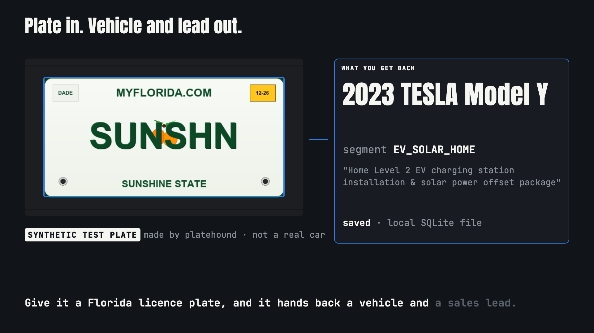

# PlateHound 🐾🚗

PlateHound is a Python command-line prototype for developers and homelab tinkerers: give it a Florida plate as text or an image, and it prints a vehicle spec card, a sales segment and a pitch, then saves the lead to a local SQLite file you can filter and export.

[](https://nojuannobody.github.io/platehound/explainer/explainer.mp4)

[▶ Watch the 72-second explainer](https://nojuannobody.github.io/platehound/explainer/explainer.mp4) · [Read the one-page explainer](https://nojuannobody.github.io/platehound/explainer/)

**How it works for you**

1. Run `generate-plates` to draw 8 synthetic Florida-style test plates (or type a plate with `scan`).
2. Run `scan-image samples/plates/SUNSHN.png`: it reads the plate, cleans it and checks it against Florida plate patterns.
3. For the 8 sample plates, a VIN stored in the code is decoded by the public NHTSA vPIC API into make, model, year, body and engine. Any other plate gets a placeholder vehicle.
4. Rules pick one of 5 lead segments and a fixed pitch line.
5. The lead is saved to `platehound_leads.db`; scanning the same plate again adds a sighting.
6. Use `list`, `search`, `stats`, and `export --format html|csv|json` to review and share the leads.

> **Status:** working prototype. Real vehicle specs exist only for the 8 built-in sample plates; there is no real plate-to-vehicle or owner lookup. Without the `tesseract` binary installed, `scan-image` reads the plate text stored in the PNG's metadata (or the filename), not the pixels. Use synthetic plates or plates you own.

**Open-Source Florida ALPR, Public Vehicle Specs Enrichment & Homelab Outreach Leads Engine**

PlateHound reads Florida license plate strings or images through a modular open-source ALPR pipeline (plate box from PNG metadata or a brightness heuristic — no YOLO model is bundled — plus optional Tesseract OCR & context-aware confusion normalization), enriches the 8 built-in sample plates via live **NHTSA vPIC** (VIN decode of a VIN stored in the code; other plates get a placeholder vehicle) (`make`, `model`, `year`, `body_class`, `engine_info`, `drive_type`, `fuel_type`, `vin_masked`), and indexes actionable outreach leads into a local SQLite database without owner data (note: the plate text and your free-text `--note` are stored unencrypted, which may count as personal data where you live).

---

## ✨ Key Features

- **Dual-Mode Florida ALPR (`platehound/detector.py`)**:
  - **Image Mode (`scan-image`)**: Bounding-box localization (`[x, y, w, h]`) + `pytesseract` OCR with automatic metadata/feature fallback.
  - **String Mode (`scan`)**: Regex validation for Florida standard, commercial truck, and vanity tags (`FLFAST`, `SUNSHN`, `76BCDE`) plus context-aware OCR confusion correction (`0`/`O`, `1`/`I`, `8`/`B`, `5`/`S`, `2`/`Z`).
- **Synthetic Florida Plate Lab (`platehound/plate_generator.py`)**:
  - Generates photorealistic Florida license plate PNGs (`MYFLORIDA.COM` header, citrus orange graphic, embossed dark-green characters, `SUNSHINE STATE` footer, registration decal) for local ALPR benchmarking.
- **Live NHTSA vPIC & Public Specs Resolver (`platehound/lookup.py`)**:
  - Queries `https://vpic.nhtsa.dot.gov/api/vehicles/DecodeVinValues/{vin}?format=json` with a 3.0s timeout and instant offline homelab cache fallback.
  - Masks sequential VIN serial digits (`1FTFW1E8***A00001`) to preserve 100% privacy while retaining WMI + VDS vehicle specifications.
  - Automatically classifies vehicles into **5 Outreach Lead Segments**:
    - `EV_SOLAR_HOME` (EVs/Hybrids -> Home Level-2 charger & solar offset pitch)
    - `COMMERCIAL_FLEET` (Pickups/Class 2+ trucks -> Fleet maintenance & commercial upfit pitch)
    - `PERFORMANCE_DETAIL` (Sports cars/Luxury coupes -> Ceramic coating & paint protection pitch)
    - `OFFROAD_ACCESSORY` (4WD SUVs/Wranglers -> LED lighting, armor & suspension lift pitch)
    - `EXTENDED_WARRANTY_SERVICE` (Sedans/SUVs 2018–2022 -> Preventative maintenance & tire packages)
- **Homelab SQLite Leads Database & Exporters (`platehound/database.py`, `platehound/exporter.py`)**:
  - Auto-migrating SQLite schema tracking sighting counts (`sightings_count`), confidence scores, and outreach pitches.
  - Exports to **CSV**, **JSON**, and a self-contained **Interactive Dark-Mode HTML Outreach Dashboard (`outreach_leads.html`)**.
- **SOOP Motion Promo Video (`media/`)**:
  - Beat-synced 12-second promo reels rendered at 30fps in `16:9` (`1920x1080`), `9:16` (`1080x1920`), and `1:1` (`1080x1080`) with synthesized audio normalized to `-14.4 LUFS`.

---

## 🚀 Quick Start

```bash
# 1. Generate synthetic Florida license plate images
python3 -m platehound.cli generate-plates

# 2. Scan a license plate image via ALPR + NHTSA lookup
python3 -m platehound.cli scan-image samples/plates/76BCDE.png --note "Observed near Miami logistics hub"

# 3. Scan a raw license plate string
python3 -m platehound.cli scan "FL-76BCDE" --note "Biscayne Blvd fleet sighting"

# 4. Run full 8-plate Florida batch enrichment demo
python3 -m platehound.cli batch-demo

# 5. View homelab analytics & filter leads
python3 -m platehound.cli stats
python3 -m platehound.cli search --segment EV_SOLAR_HOME
python3 -m platehound.cli list

# 6. Export interactive HTML Outreach Leads Dashboard, CSV, or JSON
python3 -m platehound.cli export --format html --output outreach_leads.html
python3 -m platehound.cli export --format csv --output leads.csv
```

---

## 🧪 Testing

Run the full 14-test unit and integration test suite:

```bash
python3 -m unittest discover -s tests -p "test_*.py" -v
```
